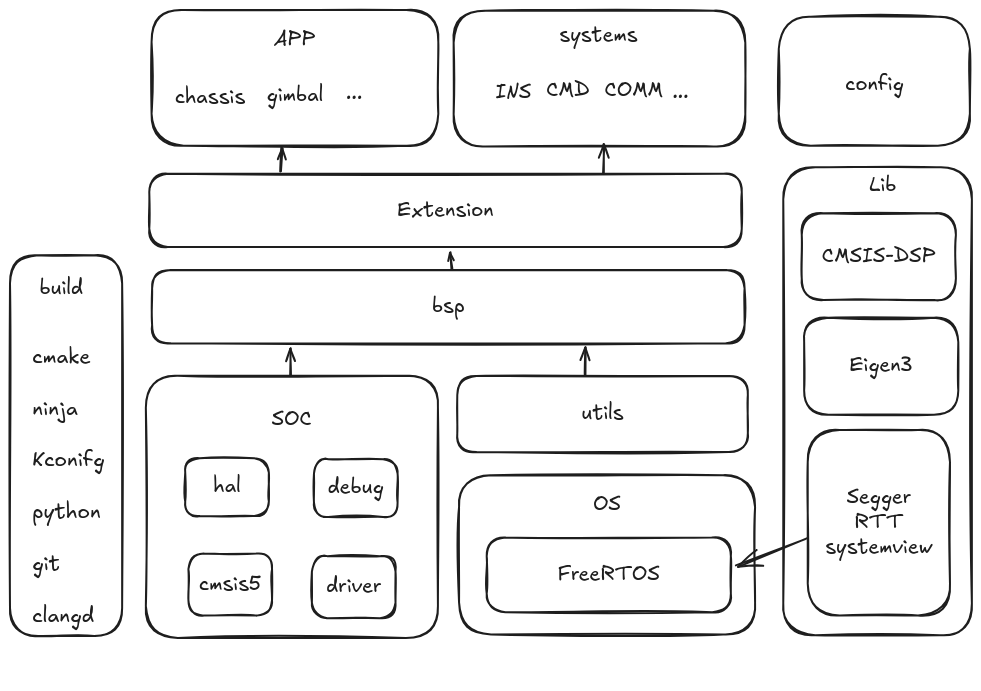

# PinyCore
<p align="center">
    <a href="http://commitizen.github.io/cz-cli/"></a>
    <a href="https://github.com/semantic-release/semantic-release"></a>
</p>

At present, this repository does not implement any specific unit type, only providing a basic framework. Only generic code should be PRed to this repository. PRs to this repository are required only when the app-layer modules are stably implemented and compatible with all code, or during specific periods (e.g., final form review). Other parts that need to be implemented by yourself:

1. App layer
2. Logic configuration of cmd input

****

👉 [Click here to view details](./.docs/profile.md)

# 🎯Requirements

1. cmake >= 3.24
2. ninja >= 1.1
3. [arm-none-eabi-toolchains](https://developer.arm.com/downloads/-/arm-gnu-toolchain-downloads) >= 10.3.1 or [llvm](https://github.com/arm/arm-toolchain) (experimental)
4. python >= 3.2
5. [kconfiglib](https://github.com/ulfalizer/Kconfiglib)

we also suggest to install following software:
1. [clangd](https://clangd.llvm.org/) >= 20.0
2. clang-format >= 20.0
3. [commitizen](https://github.com/commitizen/cz-cli)
4. ccache

# 🌟Getting started
## 🏗️Build & Compile

**Build**

```sh
cmake -B build -G Ninja
```

**Compile**

```sh
ninja -C build
```

****

Support configuring projects based on Kconfig

```sh
cmake --build ./build --target menuconfig
```

Support building projects directly based on pre-configured files (which should exist in the root directory, with the file name "yourconfig" in this example)

```sh
cmake -B build -G Ninja -DCONFIG_NAME=yourconfig
```

## 🐞Debug

1. openocd >= 0.12.0
2. [cortex-debug](https://github.com/Marus/cortex-debug) / [codelldb](https://github.com/vadimcn/codelldb) (vscode-plugin)
3. Ozone 3.24
4. FreeMASTER/FreeMASTER Lite >= 3.1.3 (后者支持Linux，需装前置Java JRE)
5. systemview

## ⚠️Notice

1. It is dangerous to call HAL library functions before the main function is executed! Please avoid making class objects that call HAL library constructors global variables (you can create global pointers, or use the tools in ./Src/Utils/Lazy and construct them during the initialization phase);
2. During the initial build, this project will automatically pull third-party libraries from GitHub. Please ensure that the network is available.

## 🧩Framework



# 🙌Contributing

Contributions are always welcome!

See [CONTRIBUTING](./.docs/CONTRIBUTING.md) for ways to get started.

Please adhere to this project's [CODE_OF_CONDUCT](./.docs/CODE_OF_CONDUCT.md).

> [!IMPORTANT]
> PinyCore is still in early development, and is not yet complete. It should be stable enough and we have
> been daily driving it for quite a while, but expect some bugs and possibly breaking changes to the
> config file.
