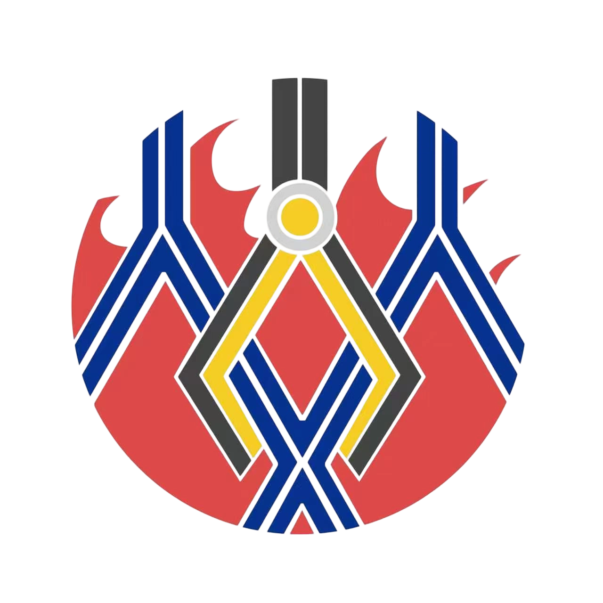

<p align="center">
    
</p>

# PinyCore

<p align="center">
    <a href="./README.md">English</a> | <a href="./README.zh-CN.md">中文</a>
</p>

<p align="center">
    <a href="http://commitizen.github.io/cz-cli/"></a>
    <a href="https://github.com/semantic-release/semantic-release"></a>
</p>

**PinyCore** 是一个面向嵌入式机器人系统的通用、可复用控制框架，不止服务于RoboMaster。它为不同兵种共享的通用基础设施提供支持，包括 SoC/BSP 硬件抽象、基于 FreeRTOS 的任务调度与通信、日志与故障处理、状态机支持，以及由 Kconfig 驱动的构建配置。项目旨在将应用逻辑与底层硬件解耦，并为具体兵种实现提供稳定的构建接口。

PinyCore 未实现任何具体兵种类型或应用专用行为。本仓库仅提供核心框架；具体的机器人实现应位于应用层，或存放在依赖 PinyCore 的独立项目中。

为了保持 PinyCore 的复用性和跨项目兼容性，本仓库仅应提交通用代码。应用专用模块、板级专用配置以及特定兵种相关逻辑应保留在核心框架之外。仅在以下情况下，才建议向 PinyCore 提交 PR：

- 应用层模块已实现并稳定，其通用部分可在不破坏现有代码兼容性的前提下复用；或
- 正处于特定集成阶段（例如最终形态审查）并集中收集相关修改。

以下部分不提供开箱即用的实现，需要用户自行完成：

1. **应用层**：具体兵种控制逻辑、任务组织、状态转换与高层行为。
2. **指令输入逻辑配置**：应用控制源的输入映射、滤波、模式处理与指令分发。

****

👉 [点击此处查看详情](./.docs/profile.md)

# 🎯 需求

1. cmake >= 3.24
2. ninja >= 1.1
3. [arm-none-eabi-toolchains](https://developer.arm.com/downloads/-/arm-gnu-toolchain-downloads) >= 10.3.1 或 [llvm](https://github.com/arm/arm-toolchain)（实验性）
4. python >= 3.2（Ubuntu 下可能还需要 python-is-python3）
5. [kconfiglib](https://github.com/ulfalizer/Kconfiglib)

还建议安装以下软件：

1. [clangd](https://clangd.llvm.org/) >= 20.0
2. clang-format >= 20.0
3. [commitizen](https://github.com/commitizen/cz-cli)
4. ccache

# 🌟 快速开始

## 🏗️ 构建与编译

**构建**

```sh
cmake -B build -G Ninja
```

**编译**

```sh
ninja -C build
```

****

支持基于 Kconfig 配置项目：

```sh
cmake --build ./build --target menuconfig
```

支持直接基于预配置文件构建项目（预配置文件应位于根目录，本示例中的文件名为 `yourconfig`）：

```sh
cmake -B build -G Ninja -DCONFIG_NAME=yourconfig
```

## 🐞 调试

1. openocd >= 0.12.0
2. [cortex-debug](https://github.com/Marus/cortex-debug) / [codelldb](https://github.com/vadimcn/codelldb)（VSCode 插件）
3. Ozone 3.24
4. FreeMASTER/FreeMASTER Lite >= 3.1.3（Lite 支持 Linux，且需要安装 JRE 前置依赖）
5. systemview

## ⚠️ 注意事项

1. 在 `main` 函数执行前调用 HAL 库函数是危险的！请避免将调用 HAL 库构造函数的类对象定义为全局变量（可以创建全局指针，或在初始化阶段使用 `./Src/Utils/Lazy` 中的工具进行构造）。
2. 首次构建时，本项目会自动从 GitHub 拉取第三方库。请确保网络可用。

## 🧩 框架


# 🙌 贡献

欢迎任何形式的贡献！

请参阅 [CONTRIBUTING](./.docs/CONTRIBUTING.md) 了解如何开始。

请遵守本项目的 [CODE_OF_CONDUCT](./.docs/CODE_OF_CONDUCT.md)。
